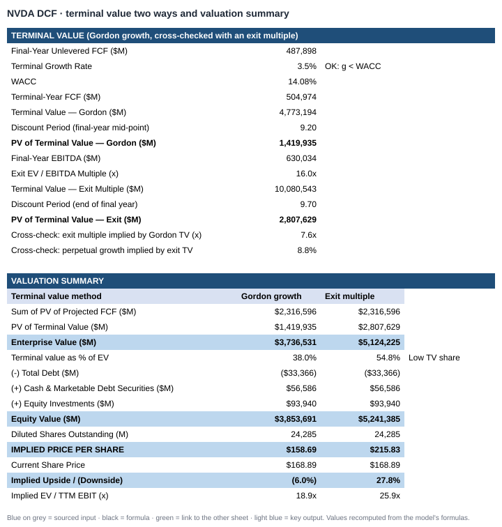
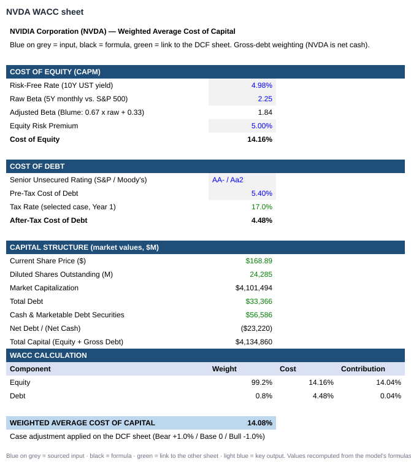
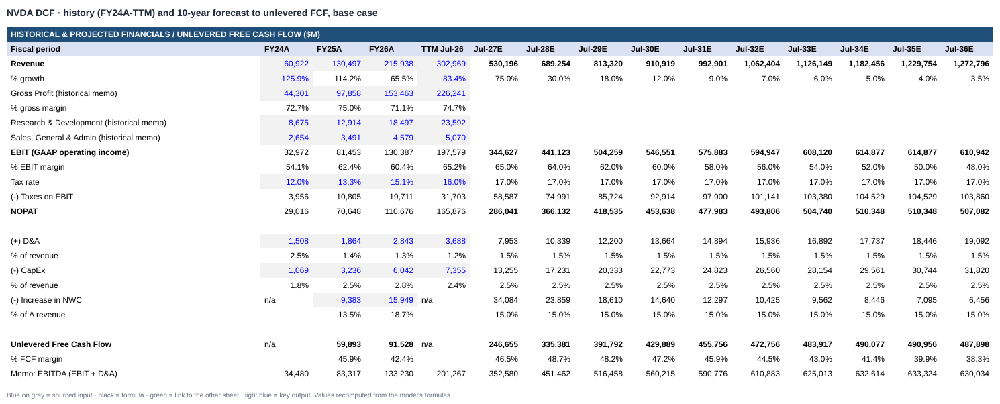
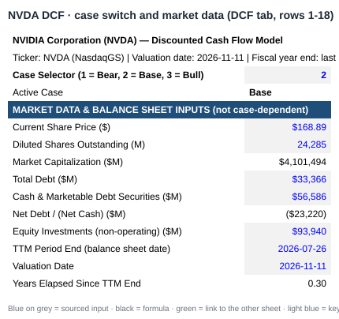
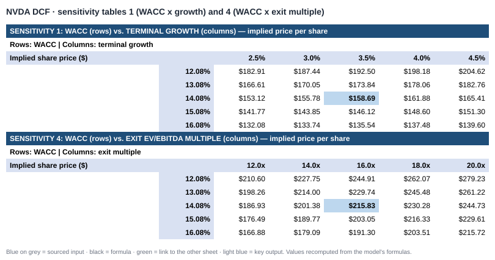

# Valuation Tutor

**Learn to build a professional DCF by building one: an AI skill that teaches the three financial statements, a linked forecast model and a 10-year DCF of any company you choose, in a live spreadsheet beside the chat.**

*Author: Tian Wei*

---

## Who it's for

- **University students** in finance, accounting, economics or business analytics who want the modelling skills that investment-banking, equity-research and corporate-finance internships test.
- **Career switchers** preparing for a modelling test or a valuation interview.
- **Self-learners** who know what revenue and profit are, and want to reach a bank-style DCF without paying for a course.

| Track | For | Time | Ends with |
|---|---|---|---|
| **Standard** | Beginners | about 10 hours | A 10-year DCF of a company you choose |
| **Advanced** | People who already know the three statements | about 25–30 hours | The same DCF built mostly by you, plus comps, peer beta and an end-to-end capstone |

## What you'll build

A bank-style DCF of **any listed company you pick**: the AI pulls its filings and market data, you build the model. The examples below are the course's worked example, NVIDIA, with figures as of 2026-11-11.

Two sheets (DCF and WACC), three cases on one switch, ten forecast years, mid-year discounting with a stub period, terminal value by perpetual growth **and** exit multiple with cross-checks, a full equity bridge, and four sensitivity tables.

**Valuation summary**



**WACC sheet**



<details>
<summary><b>More clips: the 10-year forecast, the inputs and the sensitivity tables</b></summary>







</details>

## How it works

- **Learn by building, no quizzes.** Each lesson is a short story, the key terms, a worked example, then you build the next part yourself and the AI checks your formulas, not just your numbers.
- **A real spreadsheet.** On claude.ai you work in a live Claude Sheet beside the chat; in other apps, in an Excel file the AI builds for you. Banking colours throughout: blue inputs, black formulas, green links.
- **Each technique explained once.** `$` anchoring, `CHOOSE`, `SUMPRODUCT`, discount factors and the rest are explained the first time you need them, with the logic and the formula, and not repeated unless you ask.
- **No data hunting.** Practice businesses come with their numbers; for real companies the AI pulls the figures from filings and market sources and shows where each came from.

## Course map

**Standard track**

| Part | Lessons | Time |
|---|---|---|
| 1 The three statements | 1 Income statement · 2 Balance sheet · 3 Cash flow statement · 4 How the three link | 2 h 45 |
| 2 The linked model | 5 Forecast drivers · 6 Working capital · 7 Fixed assets · 8 Debt and interest · 9 A three-year model that balances | 3 h 20 |
| 3 The DCF: your company | 10 Time value · 11 Choose the company; history and free cash flow · 12 Ten-year forecast · 13 WACC · 14 Terminal value and share price · 15 Sensitivity tables | 4 h 15 |

Parts 1–2 use a made-up business (Maya's taco truck, which grows into a three-truck company) so the ideas come before real-world complexity. In Part 3 you pick the company; NVIDIA is the worked example if you'd rather follow along with exact answers.

**Advanced track**

| Part | Lessons | Time |
|---|---|---|
| 1 Linking and the model | Builds from scratch, twists and bug hunts | 5 h 30 |
| 2 Comps and beta | Equity value vs EV, multiples, a comps set, peer beta | 2 h 25 |
| 3 The DCF: your company | The standard track's model, with almost every formula left to you | 4 h 50 |
| 4 Capstone | A full valuation end to end: linked model, comps, WACC from peers, DCF and memo | 12–18 h |

## Works with

| AI app | Works? | Practice space |
|---|---|---|
| **claude.ai** (a plan with Skills) | Best experience | Live Claude Sheet beside the chat |
| **Claude Code** | Yes | Excel file in your working folder |
| **OpenAI Codex** | Yes | Excel file in your working folder |
| **ChatGPT desktop app** (Plus or higher recommended) | Yes, where your plan offers skills | Excel file to download and re-attach |
| ChatGPT Free, or chat apps without skills or code tools | Not recommended | — |

Building your own company needs web access, because the AI pulls its filings; the made-up lessons and the NVIDIA example work without it.

## Install

**claude.ai**
1. Download [`dist/valuation-tutor.zip`](dist/valuation-tutor.zip).
2. Go to **Customize → Skills**, upload the zip and switch it on.
3. Create a **Project** called "Valuation Course" and start a new chat inside it.

**Claude Code**
```bash
git clone https://github.com/tw0507/dcf-valuation-tutor.git
cp -r dcf-valuation-tutor/valuation-tutor ~/.claude/skills/valuation-tutor
pip install openpyxl
```
Then run `claude` in a folder where you want your practice files.

**OpenAI Codex**
```bash
git clone https://github.com/tw0507/dcf-valuation-tutor.git
mkdir -p ~/.agents/skills
cp -r dcf-valuation-tutor/valuation-tutor ~/.agents/skills/valuation-tutor
pip install openpyxl
```
Then run `codex` in a folder where you want your practice files (you can also pick the skill with `$valuation-tutor`).

**ChatGPT desktop app**
Download [`dist/valuation-tutor.zip`](dist/valuation-tutor.zip) and add it as a skill in the ChatGPT desktop app (see OpenAI's guide to skills). Practice files arrive as downloads.

On Windows, copy the folder to `%USERPROFILE%\.claude\skills\` (Claude Code) or `%USERPROFILE%\.agents\skills\` (Codex) instead.

## How to use

Type these in the chat:

| Say | What happens |
|---|---|
| **start my valuation course** | Pick a track; the course panel shows every lesson; lesson 1 begins |
| **continue my valuation course** | Picks up where you left off (paste your progress record if the app can't find it) |
| **check** | The AI reads your spreadsheet and tells you what's right and what to fix |
| **contents** (or **panel**) | Shows the course panel with your progress |
| **start at Part 3**, **skip to lesson 9**, **skip this lesson** | Jumps ahead; skipped lessons stay available |
| **show me the answer** | Shows the formula for a cell you're stuck on |
| **how does $ work again?** | Re-explains a technique you've already seen |

The course panel, shown at the start, at the end of each session and on request:

```
Valuation Course · standard track                overall: ████░░░░░░ 40%
------------------------------------------------------------------------
Part 1  The three statements    (1-4)    [██████████]  done
Part 2  The linked model        (5-9)    [████░░░░░░]  in progress
Part 3  The DCF: your company  (10-15)  [░░░░░░░░░░]  not started
------------------------------------------------------------------------
Part 2  The linked model                                        3 h 20
   5  Forecast drivers                30 min  [██████████]  * done
   6  Working capital                 30 min  [██████████]  * done
   7  Fixed assets                    35 min  [█████░░░░░]  <- next
   8  Debt and interest               35 min  [░░░░░░░░░░]
   9  The linked model that balances  70 min  [░░░░░░░░░░]
------------------------------------------------------------------------
Next:       lesson 7, Practice 1
Hours:      3.8 done · about 6.6 left
```

At the end of each session the AI prints a short progress record. Keep it (or keep your chats in one project) so the next session can pick up where you stopped.

## How we checked it

- **The worked example reproduces a reference model exactly.** The NVIDIA model gives the same results as Tian Wei's original Excel model, to the cent: $158.69 a share (perpetual growth), WACC 14.08%, enterprise value $3,736,531M. The exit-multiple method and the fourth sensitivity table are additions.
- **Every answer key is recalculated, not typed.** All 694 answer keys were checked by an independent formula engine that rebuilds and recalculates each practice sheet ([`tools/check_keys.ps1`](tools/check_keys.ps1)): 0 mismatches.
- **Tested in Claude Sheets.** The full model was built in a live Claude Sheet and read back; every key output matched.
- **Sourced inputs, never from memory.** NVIDIA's figures come from its FY24 10-K, its Q4 FY26 and Q2 FY27 earnings releases and Yahoo Finance (price, beta, 10-year Treasury yield); growth, margins, the equity risk premium and exit multiples are labelled analyst assumptions.

## Repository layout

```
valuation-tutor/   the skill (zipped into dist/ for upload)
  SKILL.md         tutor rules
  curriculum.md    both tracks, lessons and times
  lessons/         standard track
  advanced/        advanced track and capstone
  scripts/         builds and reads the Excel practice files
dist/              valuation-tutor.zip, ready to upload
docs/              the model clips shown above
tools/             for authors: answer-key checker, model generator, clip renderer
```

## Licence

[MIT](LICENSE) © 2026 Tian Wei
